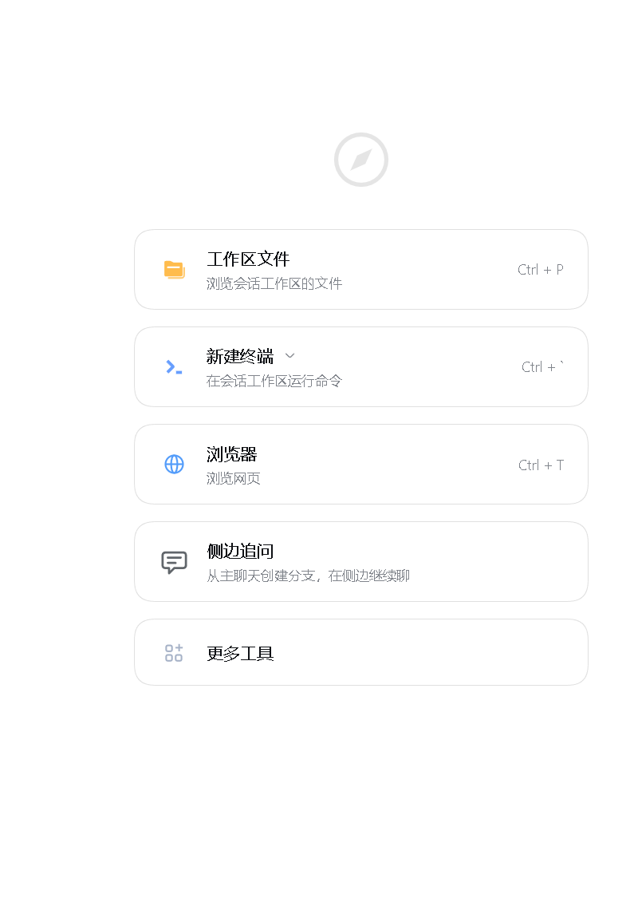
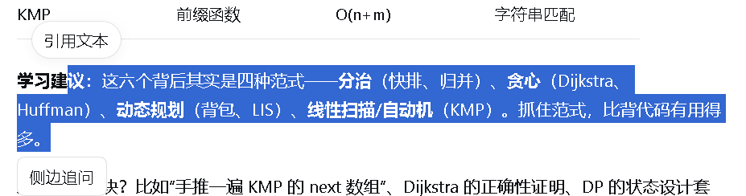
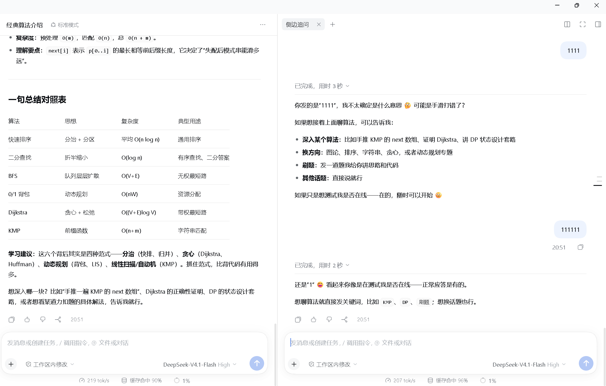

# DSH 侧边追问

面向 DeepSeek Harness 桌面版 0.2.1-rc.3 的原型。在 DSH 的「插件 → 添加插件」中填入 `github:obvious3460/dsh-side-conversation`，安装后重启 DSH。也可以先检出源码，再将完整目录作为本地插件添加。

如果使用桌面版附带的 CLI，请先完全退出 DSH，再运行以下命令。

```powershell
$dsh = "$env:LOCALAPPDATA\Programs\DeepSeek Harness\resources\runtime\cli\bin\dsh.cmd"
& $dsh plugin --profile desktop add 'github:obvious3460/dsh-side-conversation'
```

右侧栏「开始」页的「侧边追问」入口会从当前主聊天的最后一轮创建分支，并打开 DSH 原生聊天输入栏。也可以在主聊天选中一段回答，点击浮出的「侧边追问」按钮，从该回答所在轮次创建分支。主聊天需空闲且至少完成一轮。

附件、权限、模型和发送按钮沿用 DSH 原生输入栏，并作用于侧边分支。

插件创建的侧边分支会从当前 DSH 客户端的左侧会话列表隐藏。关闭侧边标签后，插件会在分支空闲时尝试归档。旧版已关闭的分支需要在 DSH 中手动归档。

侧边会话使用 DSH 原生聊天视图并跟随主题。会话有至少两轮时，右侧显示原生时间轴，悬停可预览，点击可跳转。无需 Atlas，无需构建。

## 使用截图

### 从侧边栏开始

在右侧栏「开始」页点击「侧边追问」，从主聊天最后一轮创建分支。



### 从指定回答继续聊

在主聊天中划选一段 AI 回答，点击浮出的「侧边追问」，从该回答所在轮次创建分支。



### 并排聊天

主聊天与侧边会话并排显示，可一边查看原对话，一边在右侧继续提问。侧边会话提供原生输入栏和时间轴。


